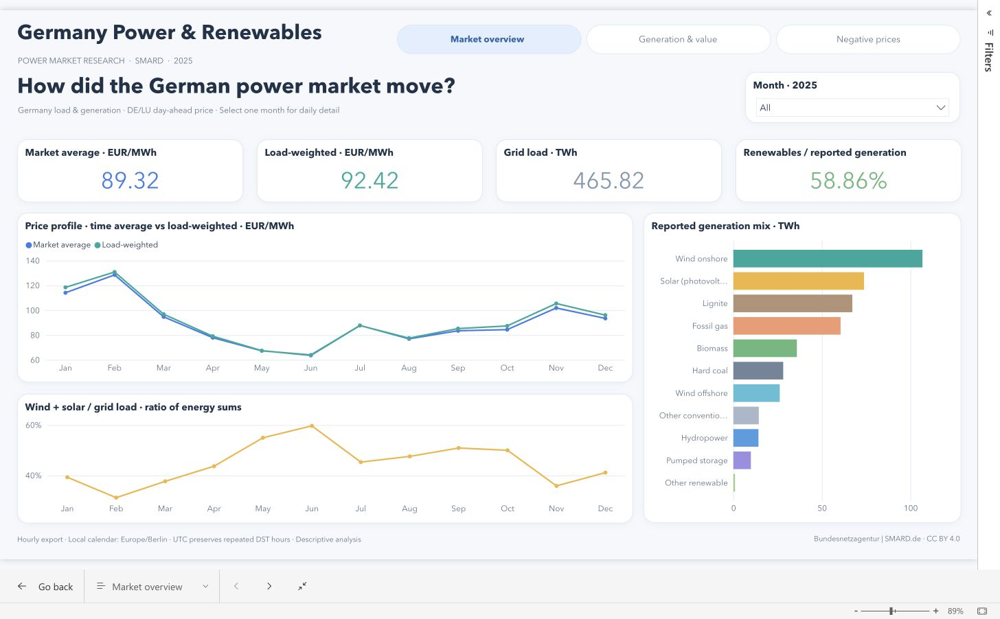

# Germany Power & Renewables

An applied research project examining how renewable generation and electricity demand align with German day-ahead prices. Microsoft Fabric provides the data preparation and validation environment; the Fabric-backed semantic model and three-page Power BI report are implemented, while unauthenticated public publication remains planned.

## Research questions

- How are wind, solar generation and residual load associated with hourly electricity prices, and how does the relationship vary by season and time of day?
- How do generation-weighted and load-weighted prices differ from the time-average market price?
- When do negative prices coincide with renewable generation and demand?

A private household extension will evaluate alternative tariffs using an observed Tibber consumption profile. Its data availability, applicable tariff periods and feasibility are still under investigation. Household records and credentials are excluded from this public research repository.

The [source dictionary](data/source_dictionary.md) explains every raw column, scope, units and missing values. The [metric and figure interpretation](research/metrics_and_figures.md) explains weights, denominators and each chart; the [data extension plan](research/data_extension_plan.md) records candidate forecast, flow and fuel datasets.

## Data and methodology

The initial dataset covers the full local calendar year 2025: 8,760 physical hours of German grid load and generation by source, matched to Germany/Luxembourg day-ahead prices. Source files are retained unchanged. Numeric fields use fixed precision, missing markers remain distinct from zero, and UTC keys distinguish the repeated autumn hour. Local dates support calendar-based analysis.

Reconciliation checks compare grid load including pumping with grid load plus pumping consumption, and residual load with grid load minus wind and solar generation. Generation is aggregated to the required grain before joins to prevent multiplication of hourly consumption and price records.

Price metrics are recomputed from hourly components. Load-weighted price is `sum(price × grid load) / sum(grid load)` over matched hours. It describes market-price exposure of the observed load profile. It is not a complete consumer bill. Hourly aggregates also cannot reconstruct within-hour price and volume covariance. Descriptive relationships are not interpreted as causal effects.

## Initial results

In the original Fabric run, January's load-weighted price was 118.49 EUR/MWh, compared with a time-average price of 114.14 EUR/MWh. June's corresponding prices were 63.60 and 63.99 EUR/MWh. The price gap therefore varies across the year; the relationship between load and price requires examination within comparable seasons and hours.

The [execution snapshot](evidence/03_explore_power_market_snapshot.ipynb) preserves the original monthly table and Matplotlib output. [Monthly results](evidence/monthly_price_profile.csv) are also available as CSV. These are captured results from the original notebook, not fresh execution outputs of the refactored notebooks.

The expanded [2025 EDA findings](research/eda_2025_findings.md) compare generation-weighted prices, negative-price exposure and calendar-adjusted associations. Solar's annual capture price was 46.07 EUR/MWh, 51.58% of the time-average market price; 24.13% of solar generation occurred during negative-price hours. Combined wind's corresponding capture price was 78.93 EUR/MWh. Residual load showed a strong positive association with price, while the apparent wind and solar associations changed after removing calendar patterns. These are descriptive findings, not causal estimates or realized revenue.

The expanded analytical cells were executed locally against the original exports, with [captured outputs](evidence/eda_2025/03_power_market_eda_local.ipynb), result tables and figures. The project author confirmed the expanded EDA completed successfully in Fabric on 9 November 2026. The generation-mix addition is figure 5 in notebook 03; the project author also confirmed that latest revision completed without errors in Fabric. The captured outputs at this link remain from the local execution. The [gold metric contract](model/gold_metric_contract.json) retains hourly components so weighted prices and rates can be recomputed for each reporting period.

## Fabric implementation

The implemented flow is raw CSV files in OneLake → validated silver Delta tables → notebook analysis. Silver contains `consumption_hour`, `generation_hour` and `price_hour`. The refactored silver build also publishes a shared UTC calendar. Notebook 04 publishes three dimensions and two hourly facts in gold; its SQL and calendar passed local validation, and the project author confirmed successful Fabric execution and all five tables on 9 November 2026.

The notebook collection separates source profiling, silver preparation, exploration and gold publication. Source profiling, the streamlined silver build and the initial separate monthly-analysis notebook have passed in Fabric according to the project author's confirmation. The expanded EDA revision also passed in Fabric on 9 November 2026; the full gold-build notebook also completed successfully in Fabric according to the project author. The original combined notebook produced the earlier preserved results.

The workspace is connected to GitHub. The `fabric/` directory contains the authoritative Fabric item definitions; `notebooks/` contains portable, output-free exports derived from that source. Captured outputs remain in `evidence/`, because Fabric Git integration versions source rather than notebook outputs. Source profiling and exploration are separate from the build flow. The silver build contains only input validation, transformation, quality gates and table publication; every code cell is part of the job.

The semantic model `sm_power_renewables` contains five gold-model relationships and nineteen core measures, plus presentation metadata and nine report measures for the adaptive axis, colors and icons. The author confirmed the headline values in Fabric, and browser checks of the connected report verified annual totals, solar capture metrics, source selection and a June date filter. The [native report definition](fabric/rpt_power_renewables.Report) contains three pages: Market overview, Generation & value, and Negative prices. The visual style follows the author's Global Critical Materials report, with a cool white canvas, blue price series, gold solar output, teal wind and coral negative-price frequency.

The report uses the existing Direct Lake model over gold; it contains no embedded copy of the source CSVs. Month selectors use calendar names and filter the individual page. A single selected month switches the timeline to days; multiple months use monthly values. Source colors and SVG icons are defined once in three small presentation tables; the five gold tables remain in Direct Lake mode. The generation-source selector changes the selected-source charts and cards, while the comparison table retains all sources for the selected months. Chart clicks do not cross-filter unrelated KPIs. Nuclear remains unavailable and is omitted where every measure is blank. Price exposure is not realized revenue or profit.

Data Factory orchestration, unauthenticated public report publication and video remain planned deliverables. No pipeline execution or public access is claimed. The [semantic specification](model/semantic_model_spec.json), [measure definitions](model/semantic_measures.dax) and browser screenshots document the implemented components.

The full generation mix, now figure 5 in notebook 03, provides context beyond wind and solar: all twelve categories are retained, with nuclear unavailable rather than replaced by zero. Wind and solar account for 47.21% of reported generation; the six renewable categories together account for 58.86%.

## Sources and attribution

Data: [Bundesnetzagentur | SMARD.de](https://www.smard.de/en/downloadcenter/download-market-data/), licensed under [CC BY 4.0](https://creativecommons.org/licenses/by/4.0/). This project converts file formats and numeric fields, resolves timestamps and derives analytical metrics. The source does not endorse the analysis.

Time handling follows [SMARD's explanation of CET/CEST and clock changes](https://www.smard.de/en/change-from-summer-to-winter-time-218202). Raw downloads were retrieved on 6 November 2026; file hashes and initial quality profiles are recorded with the data.
