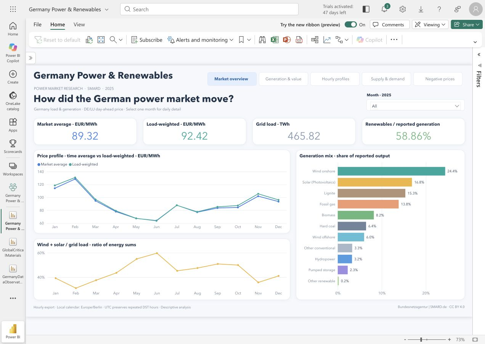

# Germany Power & Renewables

How do wind, solar generation and electricity demand align with German day-ahead prices? This project examines when renewable generation captures market value, how the consumption profile changes price exposure, and when prices turn negative.

**[Explore the interactive dashboard](https://anastasia-klein.github.io/germany-power-renewables/)** · **[Watch the Power BI video](evidence/powerbi/archive_2026-11-18/germany_power_renewables_powerbi_ui.mp4)** · **[View the report PDF](evidence/powerbi/archive_2026-11-18/germany_power_renewables.pdf)**

## What I built

An end-to-end analysis in **Microsoft Fabric and Power BI**, covering **8,760 physical hours in 2025**. German grid load and generation by source are matched with Germany/Luxembourg day-ahead prices using UTC keys, preserving both observations of the repeated autumn hour.

The data flow runs from SMARD CSV files in OneLake through validated silver Delta tables to a five-table gold star schema, a Direct Lake semantic model and DAX measures. Separate notebooks handle source profiling, silver preparation, exploratory analysis and gold publication.

The five-page report covers **Market overview, Generation & value, Hourly profiles, Supply & demand, and Negative prices**. Month and source filters support daily detail, weekday/weekend comparisons, price distributions and generation mix. A separate HTML/CSS/JavaScript/SVG version runs on GitHub Pages.

## What I found

- **The consumption profile changes price exposure.** The annual time-average price was **89.32 EUR/MWh**, while weighting each hour by grid load gave **92.42 EUR/MWh**. The gap varied by month and was slightly negative in June.
- **Generation timing matters as well as volume.** Solar's generation-weighted price was **46.07 EUR/MWh**, or **51.58%** of the market average. Combined wind captured **78.93 EUR/MWh**. Solar output was more concentrated in low-price hours.
- **Negative prices were concentrated in particular periods.** There were **573 negative-price hours (6.54%)**. **24.13% of solar generation** occurred during those hours. June alone accounted for 141 negative hours.
- **Residual load provided useful context for price movements.** Its raw correlation with price was **0.876**, compared with **0.346** for grid load alone. Calendar adjustment weakened the solar association and strengthened the wind association, showing why an annual correlation needs seasonal and hourly context.

These are descriptive relationships, not causal effects. Capture prices measure market-price exposure, not realised revenue or profit. The analysis uses hourly exports, including after the switch to quarter-hour day-ahead products in October 2025.

## Explore the research

- [Detailed findings and figures](research/eda_2025_findings.md) · [Metric definitions and chart interpretation](research/metrics_and_figures.md)
- [Source data dictionary](data/source_dictionary.md) · [Research notebooks with Fabric outputs](evidence/fabric_runs/2026-11-18/)
- [Technical implementation, validation and archive](research/implementation_and_validation.md)
- [Tibber Household Lab](https://github.com/anastasia-klein/tibber-household-lab) — a separate local application for household consumption and tariff scenarios. Public code, your own API token, private data stored on your computer.

## Data source

[Bundesnetzagentur | SMARD.de](https://www.smard.de/en/downloadcenter/download-market-data/), licensed under [CC BY 4.0](https://creativecommons.org/licenses/by/4.0/). The analysis covers consumption and all reported generation categories, alongside DE/LU prices. Missing nuclear observations remain unavailable rather than being replaced with zero.
