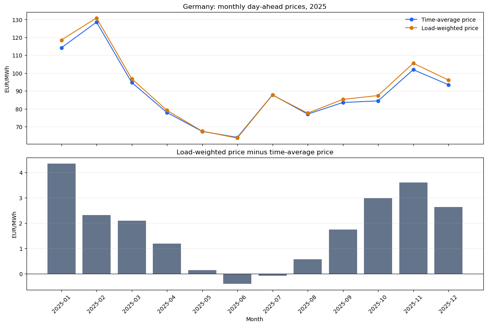

# Germany Power & Renewables

An applied research project examining how renewable generation and electricity demand align with German day-ahead prices. Microsoft Fabric provides the data preparation and validation environment; a Power BI semantic model and public report are planned as the research develops.

## Research questions

- How are wind, solar generation and residual load associated with hourly electricity prices, and how does the relationship vary by season and time of day?
- How do generation-weighted and load-weighted prices differ from the time-average market price?
- When do negative prices coincide with renewable generation and demand?

A private household extension will evaluate alternative tariffs using an observed Tibber consumption profile. Its data availability, applicable tariff periods and feasibility are still under investigation. Household records and credentials are excluded from this public research repository.

## Data and methodology

The initial dataset covers the full local calendar year 2025: 8,760 physical hours of German grid load and generation by source, matched to Germany/Luxembourg day-ahead prices. Source files are retained unchanged. Numeric fields use fixed precision, missing markers remain distinct from zero, and UTC keys distinguish the repeated autumn hour. Local dates support calendar-based analysis.

Reconciliation checks compare grid load including pumping with grid load plus pumping consumption, and residual load with grid load minus wind and solar generation. Generation is aggregated to the required grain before joins to prevent multiplication of hourly consumption and price records.

Price metrics are recomputed from hourly components. Load-weighted price is `sum(price × grid load) / sum(grid load)` over matched hours. It describes market-price exposure of the observed load profile. It is not a complete consumer bill. Hourly aggregates also cannot reconstruct within-hour price and volume covariance. Descriptive relationships are not interpreted as causal effects.

## Initial results

In the original Fabric run, January's load-weighted price was 118.49 EUR/MWh, compared with a time-average price of 114.14 EUR/MWh. June's corresponding prices were 63.60 and 63.99 EUR/MWh. The price gap therefore varies across the year; the relationship between load and price requires examination within comparable seasons and hours.

The [execution snapshot](evidence/03_explore_power_market_snapshot.ipynb) preserves the original monthly table and Matplotlib output. [Monthly results](evidence/monthly_price_profile.csv) are also available as CSV. These are captured results from the original notebook, not fresh execution outputs of the refactored notebooks.

## Fabric implementation

The implemented flow is raw CSV files in OneLake → validated silver Delta tables → notebook analysis. Silver contains `consumption_hour`, `generation_hour` and `price_hour`. The refactored silver build also publishes a shared UTC calendar. A reporting calendar exists in gold; analytical gold tables await the exploratory findings.

The notebook collection separates source profiling, silver preparation, exploration and gold publication. The refactored profiling notebook has passed in Fabric according to the project author's confirmation. The remaining refactored notebooks await execution validation. The original combined notebook produced the preserved results.

Data Factory orchestration, analytical gold models, DAX measures, the Power BI connection, public report and video are planned deliverables. No pipeline execution, published dashboard or semantic-model connection is claimed at this stage. Definitions and execution evidence will accompany these components as they are completed.

## Sources and attribution

Data: [Bundesnetzagentur | SMARD.de](https://www.smard.de/en/downloadcenter/download-market-data/), licensed under [CC BY 4.0](https://creativecommons.org/licenses/by/4.0/). This project converts file formats and numeric fields, resolves timestamps and derives analytical metrics. The source does not endorse the analysis.

Time handling follows [SMARD's explanation of CET/CEST and clock changes](https://www.smard.de/en/change-from-summer-to-winter-time-218202). Raw downloads were retrieved on 6 November 2026; file hashes and initial quality profiles are recorded with the data.
