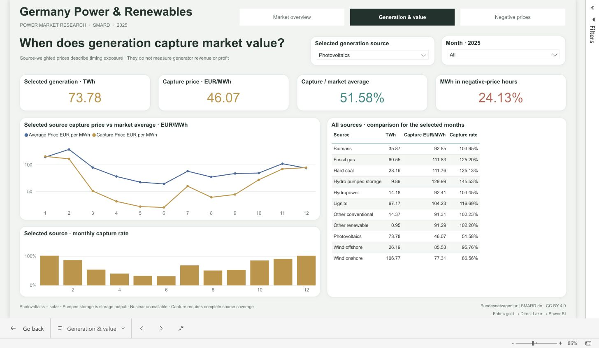
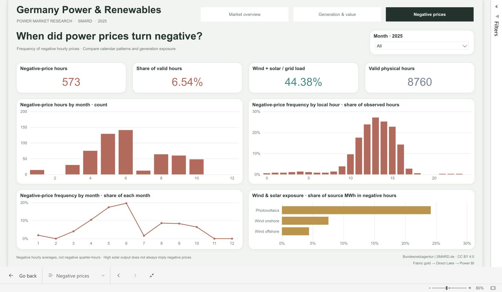

# Power BI report rendered in Microsoft Fabric

These screenshots capture the actual authenticated Fabric report, not a local mock-up. The report queries `sm_power_renewables`, which reads the five gold tables in Direct Lake mode. The browser checks and deployment state are recorded in [validation.json](validation.json).

## Market overview

Market and load-weighted prices, German grid load, renewable share of observed generation, the full generation mix and wind-plus-solar output relative to grid load. The renewable denominator includes reported pumped-storage output; nuclear observations remain unavailable.

## Generation and value

The selected source defaults to Photovoltaics. The cards and monthly charts use the selected source. The comparison table retains all sources for the selected months. Capture price is generation-weighted day-ahead price exposure, not realized generator revenue or profit. Capture rate is a ratio to the same period's market average.

## Negative prices

Counts and shares refer to negative hourly exported price values. The local-hour chart divides each hour-of-day group by its own valid observations. The wind-and-solar exposure bars divide source generation in negative-price hours by that source's matched generation volume.

The report currently requires workspace authentication. An unauthenticated public link and walkthrough video have not been created. The source design follows the author's [Global Critical Materials](https://github.com/anastasia-klein/global-critical-materials-intelligence) report, with an expanded palette for electricity-market analysis.
