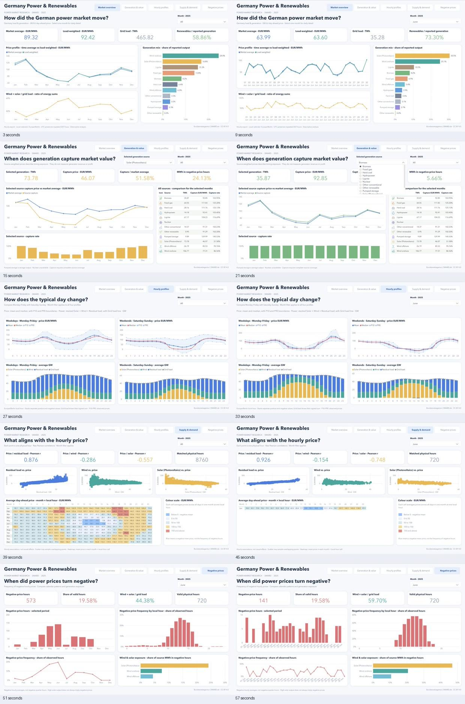

# Archived live Power BI report

- [Five-page PDF](germany_power_renewables.pdf): exported directly from Power BI with **Default Values**, all report pages included. All five pages were rendered and visually inspected.
- [Silent MP4 walkthrough](germany_power_renewables_walkthrough.mp4): approximately 57 seconds, 1238 × 700, H.264. It shows all five pages, June daily detail, Solar → Biomass selection, weekday/weekend profiles, June correlations and negative-price patterns.
- [Capture provenance and chapters](germany_power_renewables_walkthrough.json): actual report URL, frame hashes, scene times and video checksum.
- [Original Fabric report context](fabric_report_context.jpg).

The MP4 uses 89 actual browser captures of the live, connected Power BI report. Native QuickTime screen recording failed on this machine, so the walkthrough uses sampled screenshots with command-idle gaps compressed. It is not a continuous high-frame-rate recording. Charts and values were not reconstructed for the video. The MP4 was fully decoded without errors and ten sample frames were visually checked. The report was restored to its default full-year filters after capture.

Page order: Market overview → Generation & value → Hourly profiles → Supply & demand → Negative prices.

The PDF/video preserve the original Power BI presentation. Neither is an offline interactive PBIX; the separate [public web dashboard](https://anastasia-klein.github.io/germany-power-renewables/) provides independent interaction.
