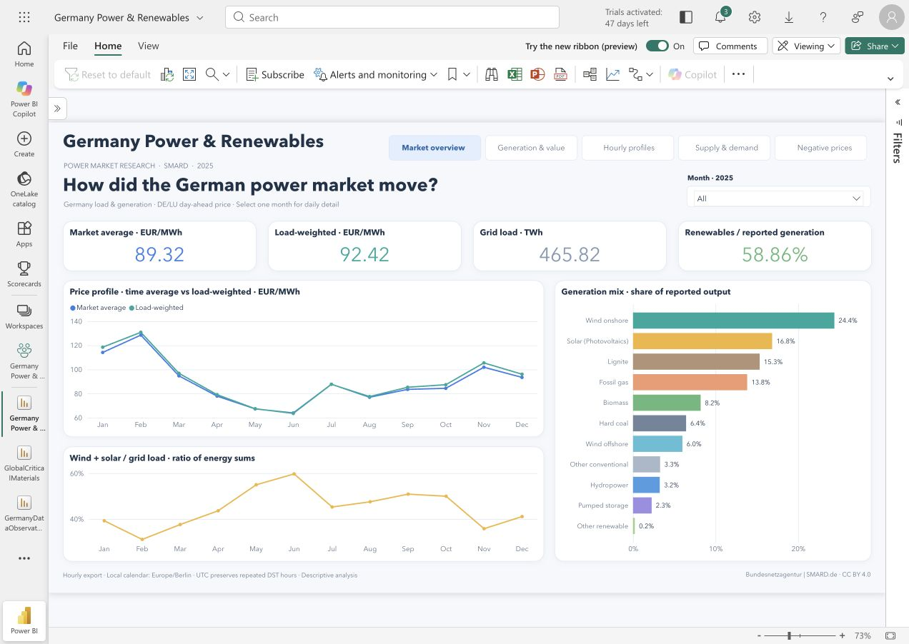

# Archived live Power BI report

**Preferred evidence video: [Power BI Service walkthrough with the application interface visible](germany_power_renewables_powerbi_ui.mp4).** The Power BI application badge, left navigation and report ribbon stay in view throughout. The opening also shows the native Pages pane; it is then collapsed to enlarge the report. All five pages, month filtering, daily detail and Solar → Biomass selection are included. [Capture provenance](germany_power_renewables_powerbi_ui.json) records its actual `app.powerbi.com` report URL and frame hashes.

- [Five-page PDF](germany_power_renewables.pdf): exported directly from Power BI with **Default Values**, all report pages included. All five pages were rendered and visually inspected.
- [Original canvas-only MP4 walkthrough](germany_power_renewables_walkthrough.mp4): approximately 57 seconds, 1238 × 700, H.264. It shows all five pages, June daily detail, Solar → Biomass selection, weekday/weekend profiles, June correlations and negative-price patterns.
- [Capture provenance and chapters](germany_power_renewables_walkthrough.json): actual report URL, frame hashes, scene times and video checksum.
- [Original Fabric report context](fabric_report_context.jpg).

The PDF/video preserve the original Power BI presentation. Neither is an offline interactive PBIX; the separate [public web dashboard](https://anastasia-klein.github.io/germany-power-renewables/) provides independent interaction.
