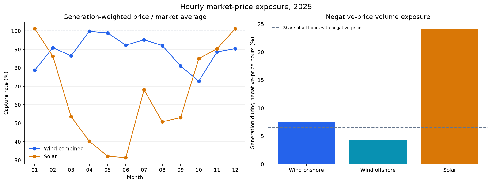
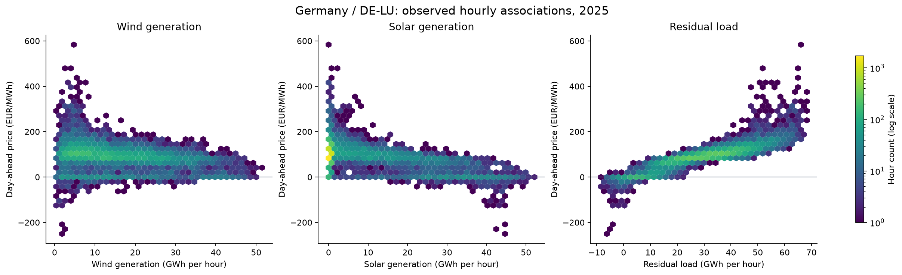
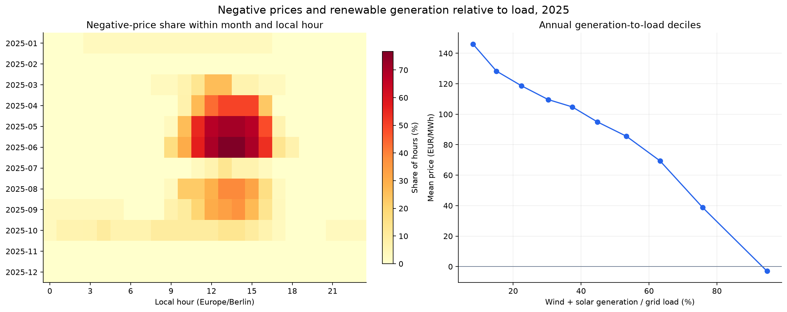

# Generation timing, residual load and market-price exposure

The 2025 hourly SMARD data support a reporting model centered on the timing of generation and consumption. Generation volume alone does not explain the market-price exposure of wind and solar. The hourly price, generation profile and grid load need to remain available together.

## Scope and execution

The analysis covers 8,760 consecutive physical hours in the local calendar year 2025. German consumption and generation are paired with the Germany/Luxembourg bidding-zone price through UTC keys. The original source files were downloaded on 6 November 2026. Missing nuclear observations remain unavailable, and negative prices remain valid data.

The source profiling, streamlined silver build and earlier monthly analysis were confirmed successful in Microsoft Fabric by the project author. The expanded EDA was executed locally on 8 November 2026 against those same original exports. Its tables and figures are captured in [the local execution snapshot](../evidence/eda_2025/03_power_market_eda_local.ipynb). This is separate from Fabric execution evidence; the expanded notebook still awaits its Fabric run.

## Generation-weighted prices differ substantially by source

| Profile | Weighted price, EUR/MWh | Weighted price / market average | Generation during negative-price hours |
| --- | ---: | ---: | ---: |
| Grid load | 92.42 | — | — |
| Wind onshore | 77.31 | 86.56% | 7.54% |
| Wind offshore | 85.53 | 95.76% | 4.40% |
| Wind combined | 78.93 | 88.37% | 6.92% |
| Solar | 46.07 | 51.58% | 24.13% |

The time-average price was 89.32 EUR/MWh. Capture price is the hourly generation-weighted market price. Capture rate compares it with the time-average market price over the same period. The volume weights for combined wind combine onshore and offshore MWh; their capture prices are not averaged equally.

Solar's pattern varies strongly by season. January and December capture rates were slightly above 100%, while June's was 31.36%: a capture price of 20.07 EUR/MWh against a market average of 63.99 EUR/MWh. In June, 46.94% of solar generation occurred during negative-price hours. This supports monthly capture metrics and separate source categories in the reporting model.

These are hourly-resolution exposure measures. They do not include contracts, hedging, subsidies, balancing, fees or actual settlement, and should not be labeled realized generator revenue or financial losses.

## Residual load is more informative than generation volume alone

| Explanatory variable | Raw Pearson correlation with price | Calendar-adjusted correlation |
| --- | ---: | ---: |
| Wind generation | -0.286 | -0.628 |
| Solar generation | -0.557 | -0.232 |
| Grid load | 0.346 | 0.277 |
| Residual load | 0.876 | 0.774 |
| Wind + solar / grid load | -0.805 | -0.737 |

Calendar adjustment removes month-by-local-hour and additive day-of-week effects from both variables. The change in correlations shows why a single annual coefficient is insufficient. Stronger adjusted wind association and weaker adjusted solar association do not establish causal magnitudes or a ranking of technologies.

The descriptive multivariate model includes wind, solar and grid load alongside calendar effects. Its associations retain the same signs when restricting the sample to local hours 08:00–17:00. Residual load is excluded from that model because it is algebraically determined by the other three quantities. Coefficients and in-sample fit remain diagnostics in the notebook, not production KPIs or a forecasting model.

The lowest annual decile of wind-and-solar generation relative to load had a mean price of 145.99 EUR/MWh. The highest decile had a mean price of -3.00 EUR/MWh, and 58.90% of its hours had negative prices. These groups differ in calendar and demand conditions; they are descriptive regimes rather than an identified price effect.

## Negative prices cluster in particular hours and seasons

There were 573 negative-price hours, 6.54% of the year, and 82 zero-price hours. June had 141 negative hours, May 129 and April 75. February, November and December had none. During negative-price hours, wind and solar together averaged 95.41% of grid load as an unweighted mean of hourly ratios; the corresponding figure for other hours was 40.96%.

The longest episode of consecutive negative hourly observations lasted 20 hours, from 4 October at 19:00 UTC to 5 October at 15:00 UTC. Episodes are built on the UTC sequence and are distinct from counts grouped by local date.

The market changed to 15-minute products on 1 October 2025. These source exports remain hourly. Counts and episodes therefore describe negative **hourly exported values**, not negative quarter-hours. Products of hourly average price and hourly energy also cannot reconstruct within-hour covariance or settlement. The October transition should remain a visible calendar attribute in gold. [SMARD: 15-minute wholesale prices](https://www.smard.de/en/15-minute-wholesale-prices-available-218078).

## Implications for gold

The [proposed metric contract](../model/gold_metric_contract.json) retains hourly facts and computes ratios from their components for each selected reporting period. The first reporting model should contain an hourly market fact and an hourly generation-source fact with shared dimensions. This consolidates the three silver inputs at the appropriate grains and avoids making Power BI join consumption and prices across fact tables for every weighted measure.

Core metrics are time-average and load-weighted prices, the load-profile price gap, generation volume and mix, wind-and-solar generation relative to load, residual load, capture price and rate, negative-price hours and source-volume exposure. Price quantiles and daily price range provide supporting distribution views. Correlations, regression coefficients and sample-derived deciles remain research outputs; they do not need permanent gold tables.

The planned analytical gold tables have not been created. The existing gold notebook still publishes only the calendar. No monthly aggregate tables are necessary for this dataset size: keeping hourly components supports month, hour, weekday and selected-period filters without averaging already aggregated prices or ratios.

## Definitions, validation and limits

- Generation MWh and consumption MWh are summed across hours; prices are never summed as a business measure. Weighted ratios are recalculated from matched numerator and denominator components.
- The renewable share denominator is total **reported generation**, including pumped-storage output. Wind-and-solar generation divided by grid load is a separate quantity and can exceed 100%; neither quantity is a household self-sufficiency measure.
- Nuclear data are missing throughout. Source-generation measures return unavailable for that category; missing values are not converted to zero. Total reported generation sums the observed categories and is labeled accordingly.
- Source-file hashes, input checks and executed-cell provenance accompany the local results. Headline metrics are checked independently using decimal arithmetic, and the new SQL panel is checked against a local SQL engine using source-derived rows. Spark execution of the new panel still requires Fabric validation.
- The external annual SMARD review also reports 89.32 EUR/MWh and 573 negative hours. Some generation totals differ from its January 2026 publication; the analysis uses the later downloaded snapshot without altering it to match rounded historical totals. [SMARD annual review](https://www.smard.de/page/en/topic-article/5892/219038/record-high-for-solar-generation-in-each-quarter).
- Residual load follows SMARD's definition: grid load minus wind and solar generation. It is not itself a direct measure of fossil generation or emissions. Imports, exports and other renewable sources remain relevant. [SMARD definition](https://www.smard.de/page/en/wiki-article/6078/6036/electricity-consumption).
- One year cannot establish a long-run trend. The associations are descriptive and do not identify a causal effect. Actual generation is observed after the day-ahead auction; the analysis is not a tradable forecast and does not substitute actuals for information available at bidding time.
