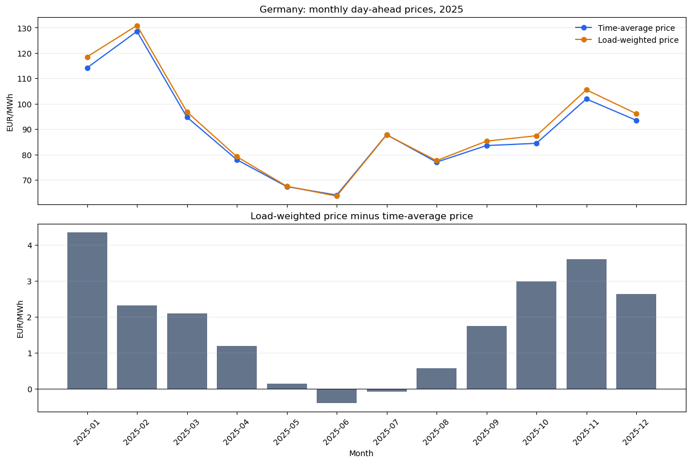
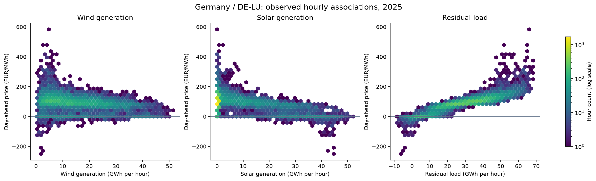
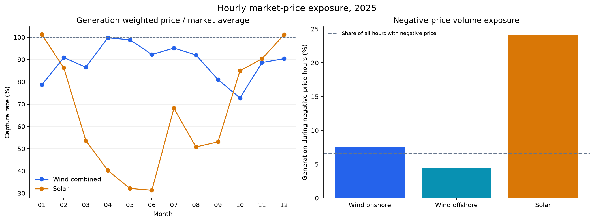
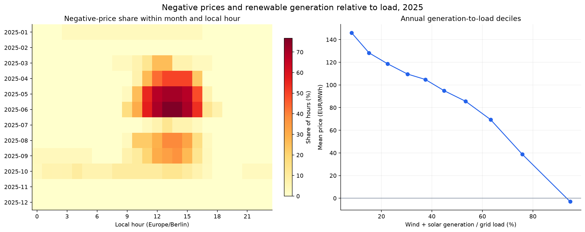
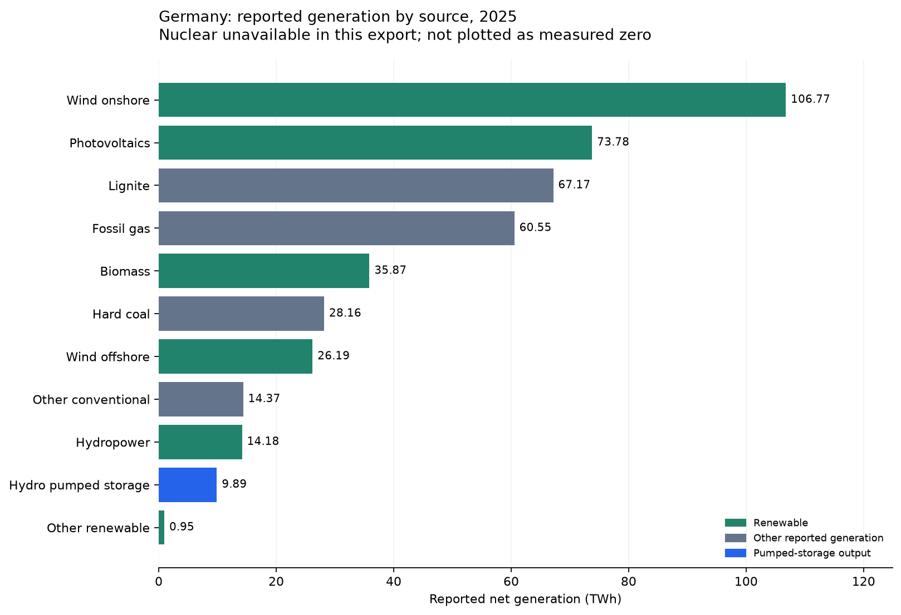

# Metrics and figures in the power-market analysis

This document explains the metrics and all five plotted figures in [03_explore_power_market](../notebooks/03_explore_power_market.ipynb), whose [Fabric source](../fabric/03_explore_power_market.Notebook/notebook-content.py) is versioned with the workspace. Figure numbers below follow their display order in that notebook. The generation-mix chart is figure 5.

The [source dictionary](../data/source_dictionary.md) defines the raw fields. Values below refer to the downloaded 2025 snapshot, not household tariffs or generator accounts. The monthly image is preserved from the original Fabric execution; the expanded EDA images are captured from local execution of the same analytical cells. They are plots, not screenshots of the Fabric interface.

## Price averages and volume weights

For hourly price `p[h]`, grid load `L[h]` and source generation `G[s,h]`:

| Metric | Formula | Interpretation |
| --- | --- | --- |
| Time-average price | `sum(p[h]) / matched_hours` | Every physical hour has equal weight; 89.32 EUR/MWh annually |
| Load-weighted price | `sum(p[h] * L[h]) / sum(L[h])` | Every MWh of grid load has equal weight; 92.42 EUR/MWh annually |
| Load-profile price gap | `load_weighted_price - time_average_price` | Difference associated with load timing; +3.10 EUR/MWh annually |
| Capture price | `sum(p[h] * G[s,h]) / sum(G[s,h])` | Every MWh from the selected source has equal weight |
| Capture rate | `capture_price / time_average_price` | Source price exposure relative to the market benchmark over the same hours |

The current load weight excludes pumping consumption. Capture volumes use the relevant source, not total generation or grid load. The denominator and numerator must use the same valid matched observations. Ratios are recomputed after filtering, rather than averaged from monthly results.

Consider two hours with separately specified source-generation and total grid-load profiles:

| Observation | Hour 1 | Hour 2 |
| --- | ---: | ---: |
| Market price, EUR/MWh | 20 | 100 |
| Selected source generation, MWh | 8 | 2 |
| Total grid load, MWh | 45 | 55 |

The time-average price is `(20 + 100)/2 = 60 EUR/MWh`. The source capture price is `(20*8 + 100*2)/(8+2) = 36 EUR/MWh`, giving a capture rate of `36/60 = 60%`. The load-weighted price is `(20*45 + 100*55)/(45+55) = 64 EUR/MWh`.

The selected source produces more in the cheaper hour, while total load is slightly higher in the expensive hour. These profiles are inputs to two different weighting calculations; neither profile is derived from the other. The example does not describe the whole electricity-system balance: other generation, storage and cross-border exchanges are omitted. Real generation, demand and prices can be related; the formulas alone do not impose a relationship between these two profiles.

Annual source capture prices are 77.31 EUR/MWh for onshore wind, 85.53 for offshore wind, 78.93 for combined wind and 46.07 for solar. Solar's 51.58% capture rate means that its generation-weighted price is 51.58% of the period's time-average market price. Equivalently, its capture price is 48.42% below that benchmark: `1 - capture_rate = (average_price - capture_price)/average_price`. This is a relative price gap, not a financial loss. Profit or loss requires actual revenue and costs; no alternative sales opportunity at the benchmark is established here. Capture rate is also distinct from generation efficiency and generation share. Fixed contracts, support payments, hedging and other settlements are outside this calculation. A negative captured price is possible; the proposed gold measure leaves capture rate undefined for a non-positive benchmark.

## Frequency, volume exposure and the denominator of a percentage

| Result | Numerator | Denominator |
| --- | --- | --- |
| Annual negative-price hour share: 6.54% | 573 negative-price hours | 8,760 valid physical hours in 2025 |
| June negative-price hour share: 19.58% | 141 negative-price hours | 720 valid hours in June |
| Heatmap cell for June at 13:00 | June observations at local hour 13 with negative prices | All valid June observations at local hour 13; normally 30 |
| Annual solar negative-price volume exposure: 24.13% | Solar MWh in negative-price hours | All matched solar MWh in 2025 |
| June solar negative-price volume exposure: 46.94% | Solar MWh in negative-price hours in June | All matched solar MWh in June |

The dashed line in the annual volume-exposure chart represents the negative-price **hour** share, while the bars represent negative-price **volume** shares. A solar bar above the line means that solar generation is concentrated in those hours, not that the share of negative hours changed between technologies.

Each percentage inherits the period and filters in its grouping. It is a daily share only when the grouping is a date. DST days use their actual 23 or 25 hours. Zero prices are distinct from negative prices: the export contains 82 zero-price hours.

## Energy mix and load-relative ratios

Figure 5 below shows all reported source categories, including conventional generation. Nuclear remains unavailable rather than being replaced by zero.

The purpose of `(wind + solar) / grid load` is to describe variable-renewable output relative to demand, then compare price conditions across that balance. For example, the same 20 GWh of wind and solar corresponds to 50% of a 40 GWh load but only 25% of an 80 GWh load. Absolute generation alone misses this demand context. The ratio is not a generation-mix share or a measure of grid stability.

The annual ratio of wind-and-solar MWh to grid-load MWh is 44.38%. That is a different denominator from generation share. On an individual hour, this ratio can exceed 100%. It does not establish the origin of consumed electricity or household self-sufficiency. A period ratio of summed energy also differs from the unweighted average of hourly ratios: both require explicit labels.

A decrease in `(wind + solar) / grid load` means wind and solar contribute less energy relative to demand. It can result from lower wind/solar output, higher load, or both quantities changing at different rates. For example, 20/50 = 40%, while both 10/50 and 20/100 equal 20%. The remaining share to be supplied by other sources, storage discharge or imports rises; absolute residual load need not rise if total load also falls. A price increase is an observed association to investigate, not an arithmetic consequence of a falling ratio.

## Figure 1 in notebook 03: monthly prices and load-profile gap

The top panel shows two prices per month. The time-average line weights every hour equally; the load-weighted line gives greater influence to hours with higher grid load. January is 114.14 versus 118.49 EUR/MWh. February has the highest monthly mean in this sample, while June has the lowest.

The bottom bars subtract the first line from the second. January's +4.35 EUR/MWh means load was relatively more concentrated in expensive hours. June's -0.39 and July's -0.08 indicate slightly lower load-weighted prices. This is a profile association, not a causal effect or a retail billing premium. The comparison is within each month, not a comparison of monthly consumption volumes.

## Figure 2 in notebook 03: three hourly density plots

Each hexagonal cell aggregates observed hours with similar x and y values. The common color scale counts hours logarithmically: brighter cells contain more observations, not more generation. The vertical axis is day-ahead price; the horizontal axes are wind, solar and residual-load energy in GWh per hour.

- Wind: high-output hours tend to have lower prices, but output alone leaves considerable dispersion.
- Solar: the high-output side contains many low and negative prices. Season and hour affect this relationship, because solar output follows daylight and seasons.
- Residual load: prices rise strongly with demand remaining after wind and solar. The pattern is curved and retains outliers, so correlation is only a summary.

Raw Pearson correlations with price are -0.286 for wind, -0.557 for solar, +0.346 for grid load, +0.876 for residual load and -0.805 for wind-and-solar output divided by load. They do not measure causal contribution or the fraction of the electricity price set by each technology.

## Figure 3 in notebook 03: monthly capture rates and annual negative-price volume exposure

The left panel shows each month's source-weighted price divided by that month's market average. The 100% line means equal source and market prices; it does not mean full renewable demand coverage. Solar exceeds 100% slightly in January and December, but falls to 31.36% in June: 20.07 EUR/MWh captured against a market mean of 63.99. Combined wind stays closer to the benchmark for much of the year, with 72.76% in October.

The right panel compares annual source-volume exposure: onshore wind 7.54%, offshore wind 4.40% and solar 24.13%. Combined wind is 6.92% in the result table. These are shares of energy, not shares of hours. The time-based reference line is 6.54%.

## Figure 4 in notebook 03: negative-price heatmap and generation-to-load deciles

The heatmap groups observations by month and local hour. A deep color means a high frequency of negative prices within that specific month-hour group. Negative-price hours are concentrated around midday in spring and summer, with other episodes outside that pattern. It does not display solar output or the number of negative hours per whole day.

The right panel sorts all 8,760 hours by `(wind + solar) / grid load` and divides them into ten equally sized groups of 876 hours. Each dot shows the group's mean ratio and mean price. These are not chronological observations or fixed 10-percentage-point bands. The lowest group averages 8.20% and 145.99 EUR/MWh; the highest averages 94.73% and -3.00 EUR/MWh. Only 58.90% of hours in the highest group are negative, illustrating that high variable-renewable output relative to load does not deterministically imply a negative price.

The complementary table bins residual load itself. Its lowest decile has a mean price of -3.18 EUR/MWh; its highest, 170.28. Both comparisons mix calendar and demand conditions, so they are descriptive rather than counterfactual effects.

## Figure 5 in notebook 03: full reported generation mix

This figure and its accompanying table are now included in notebook 03. All twelve source categories remain in the table; nuclear is unavailable and is omitted from the bars rather than plotted as measured zero. Summed reported generation is 437.90 TWh. Renewable sources account for 58.86%; wind and solar together account for 47.21% of reported generation. Pumped-storage output is included in that denominator and classified separately from renewable generation.

The figure supplies context for the wind-and-solar analysis: conventional sources are present in the system and in the source tables. Annual volumes alone cannot identify which technology set the hourly market price. The figure has been executed locally, and the project author subsequently confirmed the latest notebook revision completed without errors in Fabric.

## Other tables in notebook 03

- Annual summary: matched coverage, energy totals, price means, negative and zero hours, minimum -250.32 and maximum 583.40 EUR/MWh.
- Price quantiles: P05 -0.1105, median 92.43 and P95 162.3535 EUR/MWh. Approximately 5% of observations fall below P05 and 5% above P95, subject to interpolation and ties. They are not confidence intervals.
- Population standard deviation: 52.10 EUR/MWh, describing dispersion of observed hourly price levels. It is not volatility of returns or a forecast error.
- Negative-price conditions: mean wind-and-solar/load ratio is 95.41% in negative hours versus 40.96% in other hours. These are means of hourly ratios, not ratios of summed energy.
- Episodes: consecutive negative hours in UTC, irrespective of local midnight. The longest lasts 20 hours, from 4 October 19:00 UTC to 5 October 15:00 UTC.
- Calendar-adjusted correlations: month-by-local-hour effects and additive weekday effects are removed from both price and explanatory variables. Residual correlations are -0.628 for wind, -0.232 for solar and +0.774 for residual load. This does not control every market driver.
- Multivariate descriptive model: wind, solar and load enter together with calendar controls. Coefficients are approximately -2.61, -2.54 and +3.06 EUR/MWh per additional GWh in the hour. Residual load is omitted because it is an arithmetic combination of these inputs. In-sample R-squared is 0.826; that is not an out-of-sample forecast score or causal variance decomposition. Signs persist in a local 08:00–17:00 sensitivity sample. No significance claims are made.
- Daily price range: daily maximum minus minimum. The mean of these daily ranges is 124.13 EUR/MWh. It does not measure achievable battery profit.
- Resolution-period table: separates January–September and October–December because the day-ahead market changed product resolution. Seasonal differences prevent a simple before/after causal interpretation.

## Why negative prices are not a solar threshold

Negative bids can clear when flexible demand, export or storage opportunities cannot absorb available offers at non-negative prices. Low demand, wind, solar, operational inflexibility, heat obligations, contracts and incentives can all matter. This is a market-clearing outcome, not a physical state in which electricity is allowed to accumulate unbalanced in the grid. [SMARD explanation](https://www.smard.de/page/en/topic-article/5892/15618/negative-electricity-prices).

Direct counterexamples occur in this export. There are 102 hours with solar output of at least 40,000 MWh and positive prices. At 03:00 local time on 1 January, the price is -0.01 EUR/MWh while reported solar is only 9.25 MWh. Small nighttime solar values can occur in estimated source data and should not be interpreted as strong solar production. These observations reject an always-negative-with-high-solar rule; they do not isolate causal effects.

The day-ahead price is formed before actual delivery. Actual generation and actual demand can be used to describe realized profiles, but are not information available at bidding time. Predictive or causal work needs additional inputs and valid publication-time alignment. [SMARD: market mechanics](https://www.smard.de/page/en/wiki-article/5884/5840/this-is-how-the-electricity-market-works).

## Interactive report: questions and interpretation

The three report pages separate market context, source timing value and negative-price exposure. They answer different questions rather than presenting a causal price model. The market page compares price and load profiles with the full reported generation mix. The value page compares technologies against the same market-price benchmark. The negative-price page separates frequency in time from exposure weighted by source energy.

The annual load-weighted price of 92.42 EUR/MWh exceeds the time average of 89.32 by 3.10 EUR/MWh: consumption is relatively concentrated in more expensive hours. Solar captures 46.07 EUR/MWh, or 51.58% of the benchmark; combined wind captures 78.93, or approximately 88.37%. These describe profile value and are not profit margins. Negative prices occur in 6.54% of hours, but coincide with 24.13% of solar generation, indicating concentrated solar exposure. Pumped-storage output captures a high price, but pumping input costs, round-trip losses and operating costs are missing, so profitability cannot be inferred.

The refreshed report uses full month names sorted chronologically. A single selected month switches the timeline to physical local dates; multiple months or the full year use monthly values. Every displayed price or ratio is recomputed at that grain. Daily negative-price shares use the actual 23, 24 or 25 physical hours, and capture rate remains unavailable when the selected period's benchmark is non-positive.

Useful extensions on the existing data include a supply-and-demand page with residual load versus price, month-by-local-hour heatmaps, daily price distributions and the duration of negative-price episodes. Fuel prices, forecasts, flows and outages would support broader explanatory work. Their absence prevents causal attribution to a single technology, and the hourly export cannot recover quarter-hour settlement exposures.
